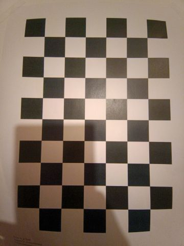
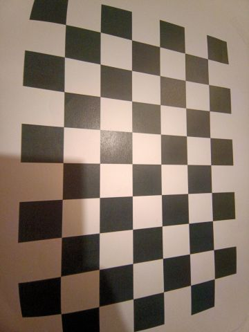
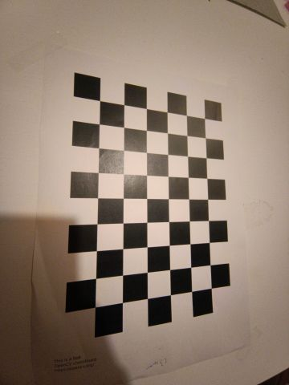
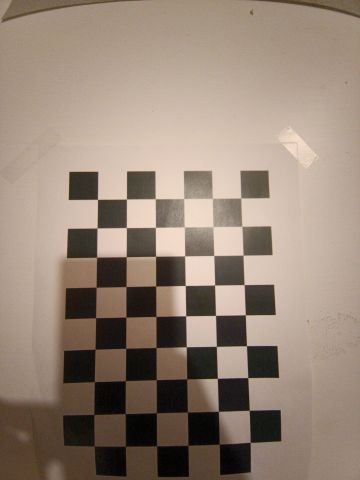
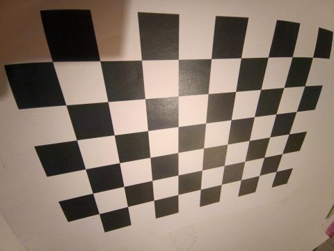
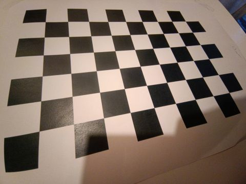
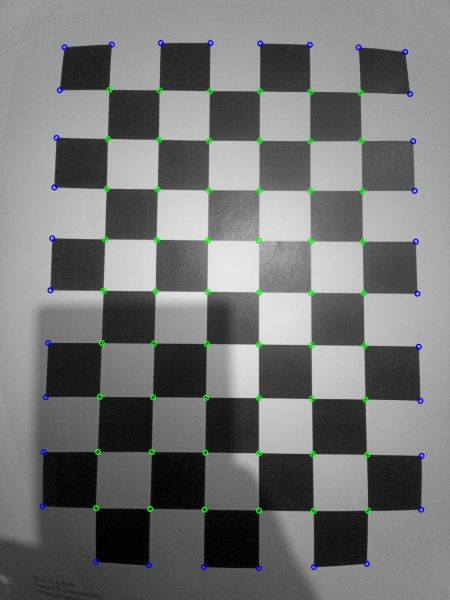
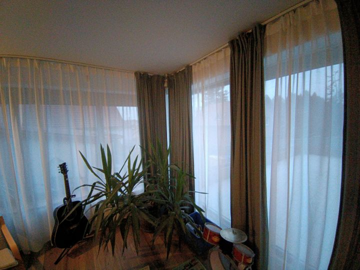
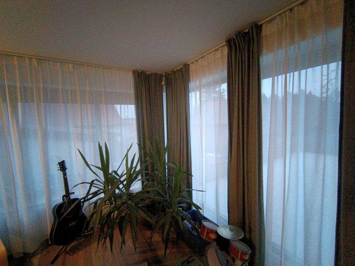

# Lens Calibration Instructions

To fix the lens distortion we need to perform what is called "camera calibration". In order to do that, a reference pattern should be printed and placed on a flat surface, ideally glued or otherwise fixed so the paper does not wrinkle or lift, which would spoil the calibration. Lens distortion correction is implemented based on the principles documented in the OpenCV library, and the following article gives a great overview of how to perform camera calibration: https://automaticaddison.com/how-to-perform-camera-calibration-using-opencv/

The result of a calibration is one small JSON file per phone model and camera (a *lens distortion profile*), committed to the repository and shipped with the app. End users never calibrate anything: they just switch on **Lens fix** in the pull-down menu. How the profile is used by the app is described in [LENS-DISTORTION.md](LENS-DISTORTION.md).

## Calibration sheet (Chessboard pattern)

For convenience, a chessboard pattern ready to be printed on A4 paper is available in the [calibration directory](calibration/lens-calibration-pattern.png). It has 10 x 7 squares (9 x 6 inner corners), which is what the calibration script expects by default (`--board 7x10`; the order of the two numbers does not matter, nor does the orientation of the sheet).

Once printed, be sure to **measure one side of a chessboard square**, as you will need this value for the calibration script later. Printed at 100 % (no "fit to page") a square is 25 mm; printers that scale the page down give a smaller value, e.g. 23 mm, which is the script's default. Give the measured value with `--square-mm`.

Strictly speaking, the square size only sets the scale of the board and has no influence on the distortion model; it is still good practice to give the real value.

## Procedure

### 1. Take the photos

Once you print the calibration sheet, place it on a flat surface and take a series of photos of the chessboard pattern from different angles and distances, with the camera you want to calibrate. Make sure the paper does not wrinkle or lift.

You need **at least 10 usable images** to get a meaningful result, the more the better: 15 to 30 per camera is a good number (the script refuses to work with fewer than 5, and drops photos that fit much worse than the others).

What matters most:

- **Cover the corners and the edges of the frame.** The distortion is strongest there, and a model that never saw them is guessed there. Take photos where the board fills the frame, and photos with the board pushed into each corner and along each edge.
- Vary the angle (tilt the phone up to 30-45 degrees against the sheet) and the distance.
- The whole board does not need to be in the frame, but **at least the inner 9 x 6 corners must be visible**, otherwise the photo is skipped.
- **Sharp photos only**: this matters more than the number of photos. Good light (daylight by a window, or bright lamps) so that the camera picks **ISO 400 or less** and a fast shutter; the phone held still, or resting on something; the board in focus. Avoid reflections on the paper. The script measures how precisely each photo's corners were found and names the blurred ones (see step 4).
- Portrait or landscape does not matter: the pixels are read as the sensor gave them.

Example photos of the Jolla Phone 2 (JP2) wide camera (`samples/wide/43`, shrunk):

| | | |
|---|---|---|
|  |  |  |
| the board fills the frame: the corners are covered | off centre, close to the edges | along one edge |
|  |  |  |
| in the bottom half | tilted, landscape | a strong angle |

For best results take the photos **with RAWfish itself** (the photo's Exif tells the script the phone's maker and model, and RAWfish's JPG keeps the sensor's pixels as they are), with these settings:

- **Lens fix off** (otherwise you calibrate an already corrected picture);
- image type **jpg** (RAWfish's own JPG). Not a bracket or burst: on some phones (the JP2 among them) those are the camera driver's JPEGs, whose pixels are turned upright; the script skips them;
- JPG processing: **Denoise classic, Frames 1**, and a moderate sharpening (the default 2 or 3). The merge of several frames (by tiles, the default of the JP2's 26 mm and 18 mm) keeps its reference frame's geometry, so it would not bias the model, but a single frame gives the crispest corners;
- the **4:3 aspect ratio**, at the camera's default size. 16:9 is just a crop of the 4:3 image: one profile serves both, as well as every resolution and the viewfinder. (Photos in 16:9 or at another resolution may be added as extra folders; they are mapped onto the 4:3 frame, but they are not needed.)

### 2. Copy the photos to the PC

Once you have all the photos, place them into their respective folders, one folder per camera (and, if you took any, one per format), e.g.:

```
samples/
  wide/43/      photo_20261125_071121.jpg ...
  std/43/
  selfie/43/
```

From the phone (developer mode, SSH enabled):

```sh
mkdir -p samples/wide/43
scp 'defaultuser@<phone-ip>:Pictures/RAWfish-ir/photo_20261125_07*.jpg' samples/wide/43/
```

### 3. Information needed

To create the calibration profiles you will additionally need this information:

| What | Where to find it | JP2 example |
|---|---|---|
| **The camera id** | On the phone: `rawfish-ir-cli cameras` lists the ids; `rawfish-ir-cli caps ID` lists each camera's JPEG sizes. The camera whose largest 4:3 size is the size of your photos is the one you photographed. The ids are NOT ordered by lens: check, do not assume | `0` main (8192x6144), `1` front (6560x4928), `2` wide (4096x3072) |
| **The board** | squares along each side, if you did not print the sheet above | `7x10` (the default) |
| **The square size** | measured on your print, in mm | `23` (the default) |
| The phone's maker and model | read from the photos' Exif (Make / Model), nothing to do; `--make` / `--model` only if the photos have none | `Jolla`, `JP2601` |
| A name for the camera | optional, for people reading the file (`--name`) | `wide` |

And on the PC: Python 3 with OpenCV and NumPy (OpenCV is only needed for the calibration, never on the phone):

```sh
python3 -m venv venv
venv/bin/pip install opencv-python numpy
```

### 4. Run the calibration script

From the repository's root:

```sh
venv/bin/python scripts/lens-calibrate.py --camera-id 2 --name wide --square-mm 23 samples/wide/43
```

The script finds the chessboard in every photo (a few minutes for 25 photos), fits the lens model and writes the profile to `android/data/lens-distortion/`, named after the phone and the camera: `distortion_<maker>-<model>_cam<ID>.json`. The output for the example above:

```
[Jolla JP2601, camera 2 (wide)]
    samples/wide/43: 30/30 photos usable, size 4096x3072
    reference frame: 4096x3072
    dropping outlier samples/wide/43/photo_20261125_071318.jpg (9.62 px, median 3.82 px of the reference)
    model: rational k1,k2,k4,k5
    fx 1737.8  fy 1735.1  cx 2049.8  cy 1516.1
    dist [-0.63853  0.18221 -0.00048  0.00002  0.      -0.66802  0.20421  0.     ]
    RMS reprojection error: 3.924 px of 4096x3072
    corner precision (each corner against its neighbours, no model): median 1.40 px
    blurred or noisy photos (precision over 2 px): photo_20261125_071124.jpg (3.2 px), photo_20261126_173229.jpg (3.2 px), photo_20261125_071121.jpg (2.4 px), photo_20261125_071140.jpg (2.2 px)
    WARNING: the corners are found imprecisely (over 1 px): the photos are blurred or noisy. Retake them in good light (ISO 400 or less), the phone still (a fast shutter, or a support)
    samples/wide/43: 29 photos, RMS 3.95 px of its own 4096x3072, reaches 96% of the centre-to-corner distance
    all together reach 96% of the centre-to-corner distance
    written: android/data/lens-distortion/distortion_jolla-jp2601_cam2.json
    check it on a photo:  rawfish-ir-cli lensfix android/data/lens-distortion/distortion_jolla-jp2601_cam2.json IN.jpg OUT.jpg
```

How to read it:

- **photos usable**: photos where the chessboard was found. If many are missing, they are blurred, too dark, or the inner corners were not all in the frame.
- **dropping outlier**: a photo that fits more than twice as badly as the median (a lifted sheet, motion blur) is left out automatically. One or two are normal; many mean the board is not flat.
- **RMS reprojection error**: how far, on average, the model puts the corners from where they were found, in pixels. With sharp photos expect **around 1 px or less** (the sharpest of the example's photos found their corners to 0.75 px). It is only as good as the corners themselves: read it with the next line.
- **corner precision**: how precisely the corners were found, measured without any lens model (each corner against the position its 8 neighbours predict; over two squares the distortion is negligible). Sharp photos in good light give well under 1 px. Photos over 2 px are listed; above 1 px overall the script warns: retake them, they limit the fit more than anything else.

  What was measured on the example above (the JP2's 18 mm, 27 Nov 2026), to show where the error comes from: the samples were taken hand-held in dim light, at ISO 2000 to 3850 and 1/24 s; the corners were found with a precision of 1.4 px (median, a few photos 2-3 px), and the fit's RMS is 3.9 px. The model is not what limits it: the inner corners alone give 3.3 px, a richer model (all the rational terms free, thin prism, a tilted sensor) at most 0.1 px less, and the residuals show no pattern across the frame (random, not systematic). The outer corners (measured by another method, intersecting the squares' sides) are only a little less precise than the inner ones (4.5 against 3.6 px of the fit), and they are what reaches the corners of the frame. The model is good enough for the correction (lines straight to the eye), but these photos should be retaken in good light for a fit of a pixel.
- **reaches N % of the centre-to-corner distance**: how far into the corners the photos go. **Aim at 90 % or more**; below 85 % the script warns: take more photos with the board in the corners.
- With several folders (e.g. 4:3 and 16:9), each one is also fitted **alone**: its focal length should agree with the joint model within a few tenths of a per cent; more than 2 % is flagged.
- **WARNING: every model folds back inside the frame**: the photos do not cover the corners well enough to model them. Take more corner photos.

To see what the script detected, add `--debug /tmp/corners`: every photo is written there with the corners found drawn on it (green: the inner corners, blue: the outer corners of the border squares, which matter most on a wide lens):



Other options: `--out FILE.json` writes elsewhere (e.g. to try a calibration without touching the shipped file); `--reference WxH` sets the camera's full frame when the photos are not of the largest 4:3 size; `--help` lists them all.

### 5. Check the profile

On a photo of the same camera (any photo: a scene with straight lines near the edges shows it best), on the PC or on the phone. It does not need a camera, only the CLI built for your machine (`scripts/check-host.sh` builds one as `/tmp/indraw-host`) or installed on the phone:

```sh
rawfish-ir-cli lensfix android/data/lens-distortion/distortion_jolla-jp2601_cam2.json photo.jpg photo_fixed.jpg
```

A photo whose Exif was stripped (e.g. sent by other users for testing or downloaded from forum) with upright pixels and no orientation tag; the command then says the pixels are turned "by an unknown rotation". Give the rotation: `rot=90` for a back camera held upright (the usual case), `rot=270` held upside down or for the front camera, `rot=180`:

```sh
rawfish-ir-cli lensfix /usr/share/rawfish-ir/lens-distortion/distortion_jolla-jp2601_cam2.json photo.jpg photo_fixed.jpg rot=90
```

Straight lines must come out straight, all the way into the corners, with no black corners:

| Before | After |
|---|---|
|  |  |

To try it live in the app before building a package, copy the file to the phone's user folder, which wins over the shipped one, and restart the app:

```sh
scp android/data/lens-distortion/distortion_jolla-jp2601_cam2.json \
    'defaultuser@<phone-ip>:.local/share/com.rawfish/rawfish-ir/device-profiles/lens-distortion/'
```

(Delete it from there afterwards, or it keeps overriding the shipped profile.)

### 6. A phone sold under several model names

The file is named after the phone the photos were taken with (`ro.product.model`). If the same camera module is sold under several model names that share one device profile (e.g. the Xperia XA2's H3113, H3123, H4113...), name the file after the module instead and point the profile to it, so that every variant finds it:

```sh
venv/bin/python scripts/lens-calibrate.py --camera-id 0 --name main \
    --out android/data/lens-distortion/distortion_sony-xperia-xa2_cam0.json samples/xa2-main/169
```

and in `android/data/device-profiles/sony-xperia-xa2.json`, in that camera's block:

```json
{ "camera_id": "0", ..., "distortion_file": "distortion_sony-xperia-xa2_cam0.json" }
```

A phone with a single model name (the JP2) needs nothing in its device profile.

### 7. Commit

Commit the new or updated `android/data/lens-distortion/distortion_*.json`. The package installs every file of that folder (`/usr/share/rawfish-ir/lens-distortion/`), and `scripts/check-host.sh` checks each one (it must parse and correct the full frame, 16:9 and the viewfinder without empty corners). The sample photos themselves are not committed.

## Troubleshooting

| Symptom | Cause, remedy |
|---|---|
| `no chessboard found` for most photos | blurred or dark photos, the inner corners not all in the frame, or another board: give `--board` |
| `skipping ... size ... (one size per folder)` / photos grouped by size | photos of several resolutions in one folder: each size is its own group, which is fine |
| `skipping ... its pixels are turned against the frame` | bracket or burst photos (the camera driver's JPEG): retake them as jpg |
| `no Make / Model in the photos' Exif` | photos not taken with RAWfish: give `--make` and `--model` exactly as the phone reports them (`ro.product.manufacturer`, `ro.product.model`) |
| the corrected photo shows curved lines near the corners | not enough coverage of the corners (check the "reaches" line), or the wrong camera id |
| the app says "no lens profile for this camera" | the file's name does not match the phone or the camera id (`distortion_<maker>-<model>_cam<ID>.json`, maker and model lowercase, other characters as `-`) |
