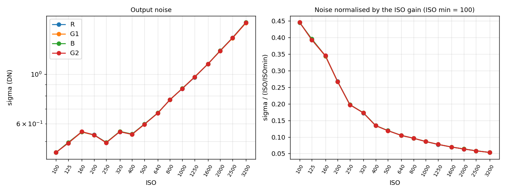

# (AI generated)
# Stacked exposures (Σ): what they compute, and why they look the way they do

## What the engine computes

A Σ shot is `n = base x denoise` RAW16 sub-frames of `sub` seconds (the
single-exposure ceiling, 1/2 s on the JP2), with the focus frozen. They are
added pixel by pixel in 32 bits. The DNG is then written as **one exposure of
`base x sub` seconds** would be:

    v   = (sum of the n frames - sum of the n frames' own black levels) / denoise
    v   = min(v, W - B)          what saturates, saturates, as in one exposure
    out = scale x (v + B)

per CFA phase, with `B` and `W` the single frame's black and white levels, each
frame's black taken from the HAL's per-frame measure (`SENSOR_DYNAMIC_BLACK_LEVEL`)
when it gives one, and `scale` the largest integer keeping `scale x W` in 16
bits (64 on a 10-bit sensor). The DNG's black and white are multiplied by the
same `scale`, so a raw developer computes exactly `(out - black) / (white - black)`
= the light of `base` sub-frames over one frame's range; the factor only keeps
the fractions that the per-frame blacks and the denoise division leave.

`denoise` takes 2x or 4x the frames and divides them back: same brightness,
noise divided by sqrt(denoise), the shot that many times longer.

## The viewfinder of a stack

A stack cannot be previewed as such. The controller previews ONE frame of
the same exposure (ISO x time): as short as `sigmaPreviewFps` (10/s by
default) allows, the ISO raised to match; past the maximum ISO the frame is
lengthened up to the 0.5 s ceiling; past that, the frame is darker than the
photo by a known factor (the deficit), which the exposure loop multiplies
back in, and the interface reports. Only AT that limit (the frame at the
ceiling and the maximum ISO) and below ~4 DN of signal (0.004 of the range,
provisional) is the frame reported as too dark to measure, the loop then
leaving the pair alone; before the limit a dark frame is a dark photo, not
a failed measure (0.47.18; 0.47.16-17 flagged it in manual too). The histogram keeps the photo's position and
clipping, with a single high-ISO frame's noise (wider into the shadows).
Rules in `sailfish/ctl_exposure.c`, tested in `sailfish/tests/exposure_test.c`.

## Sum or average?

The same thing. Summing calibrated frames and averaging them give the same
signal-to-noise ratio; averaging only keeps the numbers in the camera's range,
summing keeps the brightness of the total exposure (Sky & Telescope,
"Astrophotography stacking signal"; Siril documentation, "Sum stacking" and
"Average stacking"). RAWfish-indRAW sums because a Σ8s has to look like 8 seconds.
So yes: it *is* an addition, and that is correct.

## Why the noise is what it is

Two noises: shot noise, which depends only on the total light, and read noise,
which every read of the sensor adds once. A stack of n sub-frames carries n
reads where one long exposure carries one: the read noise grows as sqrt(n).
Google states the same for its burst pipeline: read noise depends on the number
of frames taken, which is why a burst is less efficient than one long exposure
in the shadows (Google Research, "HDR+ with Bracketing on Pixel Phones", 2021).

A simulation of the formula above (10 photo-electrons per pixel per 1/2 s
sub-frame, i.e. a dim scene; read noise 10 e- as on many phone sensors at their
lowest gain) gives, for the signal-to-noise ratio of a pixel:

| | 1/2 s pushed to the same brightness | Σ stack | one true exposure of the same length |
|---|---|---|---|
| Σ2s  (4 frames)  | 1.1 | 1.9 | 3.4 |
| Σ8s  (16 frames) | 1.0 | 3.8 | 9.9 |
| Σ32s (64 frames) | 1.1 | 7.6 | 23.5 |

and the brightness came out exact (within 0.2 %, black drift included). So:

- against raising the ISO of one 1/2 s frame to the same brightness, a stack
  is sqrt(n) times cleaner -- that is the whole point of it;
- against a true long exposure, a dim scene stays clearly noisier: the sensor
  cannot expose longer than 1/2 s here, and each extra read costs. This is a
  limit of the hardware, not of the formula.

## What actually lowers the noise

1. **The Denoise setting** (2x / 4x frames): sqrt(2) / 2 better, at 2x / 4x the
   time. Same result as a longer Σ at a lower ISO, when one exists.
2. **The sub-frames' read noise.** Many phone sensors switch to a high
   conversion gain above some ISO, where the read noise drops several times
   (dual conversion gain). In the same simulation, 16 sub-frames whose read
   noise is 1.5 e- instead of 10 e- give a SNR of 11.4 instead of 3.8 -- as good
   as one true 8 s exposure. On a dim Σ shot it can therefore be better to
   raise the ISO to the first value above that switch and shorten the Σ (or
   keep it and lower the exposure when developing). Where the switch is on a
   given phone is measured with `scripts/dcg_dark_analysis.py` (dark frames at
   a range of ISOs); on the JP2 it is still to be measured.
   **Measured on the Jolla Phone 2** (dark frames, 1/100 s, ISO 100..3200,
   October 2026; `scripts/dcg_dark_analysis.py`):

   

   Left: the noise in the file (DN), per channel. Right: the same noise
   divided by the gain (ISO / 100), i.e. referred to the light -- for a given
   amount of light it says how much noise the readout adds; lower is better.
   Data: `measurements/jp2-dark-noise.csv`.

   No dual-conversion-gain step. The output noise stays at
   about 0.5 DN from ISO 100 to 400 -- the floor of the 10-bit readout, close
   to the 0.29 DN quantisation step -- and then grows almost in proportion to
   the gain. Brought back to ISO 100 units the noise falls steadily (0.45 DN at
   ISO 100, 0.13 at 400, 0.07 at 1600, 0.05 at 3200), with no plateau.
   What it means for the JP2:
   - **ISO 100 to 400 is "free"**: for the same Σ duration, ISO 400 gives a
     picture 4 times brighter with the same output noise, i.e. shadows 4 times
     cleaner relative to the signal -- at the price of 2 stops of highlight
     headroom. In a dim Σ shot without bright lights, prefer ISO 400 to 100.
   - For a **fixed brightness**, ISO does not help: going from Σ8s ISO 100 to
     Σ2s ISO 400 collects 4 times less light. The read noise of the JP2 is
     already low at that point, so the remaining noise of a dim stack is
     mostly the shot noise of the light itself: only more light (a longer Σ,
     the Denoise setting) reduces it.
   - At ISO 100 a dim scene sits in a few DN of a 10-bit readout: this is
     where the quantisation is most visible, and where the 16-bit headroom of
     the stack's output matters.
   A photon-transfer measurement (pairs of evenly lit frames at several
   brightnesses) would turn these DN into electrons and settle the read noise
   in absolute terms; not done yet.
   **Exposure time and heat** (same method, at the Σ sub-frame length): at
   0.5 s the noise is within 1 % of the 1/100 s values with the phone cold,
   and within 2 % right after a 4-minute Σ (data:
   `measurements/jp2-dark-noise-0.5s-hot.csv`, plot alongside). The mean level
   stays on the black (64.0) in both cases. On the JP2, dark current is
   negligible at the Σ durations: the readout measurement above holds for
   stacks, and dark-frame calibration would only remove a few isolated hot
   pixels.
3. **Hot pixels and dark current** add up with the exposure exactly as in one
   long exposure; they are removed with dark frames (the same Σ, ISO and
   temperature, lens covered) subtracted from the sum. Measured negligible on
   the JP2 (above): low priority there, still the remedy on other sensors.

What does **not** help: averaging more frames of a stack that is already
summed (it is the same thing), or any digital gain (it multiplies the noise
with the signal).

## References

- Sky & Telescope, "Astrophotography stacking signal" (sum vs average: same SNR).
- Siril documentation, "Stacking" (sum stacking, average with rejection).
- Google Research blog, "HDR+ with Bracketing on Pixel Phones" (read noise per frame).
- Monod, Delon, Veit, "An Analysis and Implementation of the HDR+ Burst
  Denoising Method", IPOL 2021.
